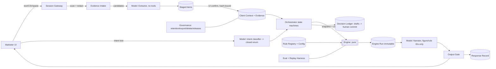

# 03. Architecture (complete; supersedes Phase 3 draft, which ended at §7)

Sections 3, 8–13 of the Phase 3 draft were missing; they are written here. Phase 3's sound design is retained: pure engine, rule registry, immutable runs, UI-only confirmation, replay by snapshot. Corrections from the Phase 4 audit are folded in; closure table in `06`.
Labels: `[Architecture]` = engineering choice (non-user-facing, changes no verdict). User-visible behaviour changes are Provisional with a `PV-xx` ID.

## 1. Guarantees → forced structure
| # | Guarantee | Forces |
|---|---|---|
| G1 | Every number, gate, verdict, level, step comes from a deterministic engine; model never decides | Pure engine, no model access; narrative bound to figure IDs |
| G2 | Every rule shows status + strength where relied on | Rule registry; labels added by code, not model |
| G3 | Failed gate never relabelled; overrides logged beside verdict | Immutable verdicts; override = separate linked record |
| G4 | Known / assumed / unknown stay apart | Computed from field basis/status + evidence flags |
| G5 | Evidence confirmed by user before use | Confirmation = UI action bound to staged-value hash; model cannot call it |
| G6 | Stored decision re-runs to same verdict | Engine pure function of versioned inputs; time is an input |
| G7 | One client per session, no cross-client reads | Scope bound at session start; enforced in storage (RLS) |
| G8 | No credentials; pasted content cannot instruct | Scanner before model; extractor has no tools; redact before persist |
| G9 | Provisional rules change without invalidating the whole test set | Versioned config + register IDs + tagged tests |
| G10 | Human decides; no write path to Meta | Model tools can only read/propose |
| G11 | Replay works across versions | Old engine/formula/rule/prompt/gate versions stay runnable |

## 2. Zones
| Zone | Contains | May be wrong? |
|---|---|---|
| Deterministic | session gateway, orchestrator, registry, engine, output gate, ledger, governance | **No.** Exhaustively tested |
| Model-assisted | extractor, dialogue/hypotheses, narrative writer | Yes, but gated and bound |
| Human | confirmation, level confirmation, definitions, overrides, commits | Logged |

## 3. System overview (was missing)

Request lifecycle (W6): gateway binds client → orchestrator loads snapshot, resolves pinned config → asks next missing field (from field matrix data) → marketer confirms staged evidence → engine run (pure) → run persisted → narrator writes structured segments → gate validates/binds/labels → response persisted atomically with run and draft log → UI shows result; marketer commits or discards draft; overrides recorded separately.
Deployment `[Architecture]`: one deployable app with hard module boundaries; engine is a standalone package with zero I/O.

## 4. Components and boundaries
| Component | Zone | Responsibility | Must never |
|---|---|---|---|
| Session gateway | Det. | Auth marketer; bind session to one client; scan inbound text for credentials; enforce scope on every call; confirm client at start/switch | Let a session touch another client |
| Intent router | Model, closed output | Classify user message to a **closed enum** (see §8) | Emit anything but an enum + confidence |
| Orchestrator | Det. | W1/W5/W6 state machines; uses field matrix to pick next missing field; calls engine | Interpret free text; compute |
| Model layer | Model | Three roles (§9) | Calculate, round, decide, confirm |
| Evidence intake | Det. + model mapping | Parse typed/paste/CSV into **staged** items; require confirmation of each value/unit/currency/period/source-system | Pass unconfirmed or image-derived value to engine |
| Client context service | Det. | Fields with status/basis/source/confirmer/time/version; staleness; conflicts; snapshots | Overwrite silently |
| Rule registry | Det. | Rules, definition slots, catalogues, ladders, decision tables, parameters as versioned data | Be edited at runtime |
| Engine | Det. | Pure functions: metrics, guardrail position, sufficiency, tracking suggestion, staleness, W1 gate, W5 states + ladder lookup, W6 sequence, verdict, Reduce, step, window | Call model, read clock, touch storage |
| Output gate | Det. | Validate claims, bind numbers, add labels, build response shape, fall back to template | Release unbound number or missing label |
| Decision ledger | Det. | Launch/learning/scaling records with replay versions; drafts model-assisted, commits human | Edit a committed verdict |
| Governance | Det. | Retention, per-client export, hard delete, rule releases, register upkeep | Share data across clients |
| Eval/replay harness | Offline + runtime | Seven layers; replay of stored runs | Be skipped before release |

**Boundary rule:** data enters the engine only through evidence items and context fields carrying a confirmation flag **and a basis**; leaves only as structured results. The model sees results by figure ID and rule ID, never raw tables.

## 5. Rule registry and knowledge layer
Stored as typed, versioned data looked up by ID; **not** semantic retrieval `[Architecture]` (retrieval can drop strength labels or blend examples into rules; fidelity tests need a closed statement set).
Entry fields: `id, kind, status, strength, page_pdf, page_printed, statement_verbatim, parameters, workflows, register_id?, default?, overridable_by?, verified:boolean, version`.
Kinds: **Gate** (Pass/Fail/Cannot evaluate) · **Ladder** (hypothesis generator) · **Catalogue** (tickable list) · **Calculation** · **Guideline range** · **Definition slot** (Marketer-set) · **Worked example** (fixture only, unreachable by model) · **Decision table** (verdict mapping, caps, steps, windows) · **Field matrix** (B/C per workflow).
Outside the registry: Meta platform behaviour (typed `platform` claim + "verify in Meta's current documentation"); general knowledge (typed `general` claim, labelled, never feeds gate/score/verdict); the stray p.5 note (excluded).
Release discipline: registry changes only by versioned release; each release runs the regression set; a session pins one version (`rule_configuration_version`), so changes never alter a half-finished conversation. Deferred items OD-01 (creative band) and OD-03 (hook window) are registered as `deferred`.
**Config hierarchy (PV-29):** `platform default (registry release) < agency override < client override`. Only Provisional/guideline parameters are overridable; GoUp firm rules (e.g. question order) are not. The **resolved effective config** (with all overrides) is hashed and stored with each run; replay uses the stored blob, not live config.
**Where logic lives:** parameters and tables (caps, verdict mapping, steps, windows, field matrix, ladders) are versioned decision tables in the registry. Structural logic (e.g. "first Cannot evaluate ends the sequence") is code in `engine/`, tagged `// @rule PV-xx`, covered by tagged tests. CI fails on untagged IDs.

## 6. Engine
Pure function: `run(request) → result`. Request = `{workflow, context_snapshot, evidence_items(confirmed), resolved_config, as_of, marketer_choices}`. No I/O, no clock, no randomness, decimal arithmetic, **total** (always returns a result, possibly "cannot evaluate"), canonical-JSON hashing. Modules, tables and algorithms: `04_ENGINE_SPEC.md`.
Replay (G11): engines are released as immutable versioned artifacts and archived (`engine-archive/vX.Y.Z`); `replay(run_id)` loads the run's engine, formula, rule-config, snapshot and evidence set and asserts `result_hash` equality.

## 7. Data model
See `05_DATA_MODEL.md`. Principles: append-only history; every run points to an immutable snapshot + evidence hash; every row names its client; RLS enforces scope.

## 8. Orchestrator, intent routing and deferred handling (was missing / F-21)
The orchestrator never reads free text. A model **intent classifier** returns one closed enum:
`W1 | W5 | W6 | provide_data | confirm_pending | switch_client | deferred_W2 | deferred_W3 | deferred_W4 | deferred_W7 | outside_framework | benchmark_request | credential_offered | meta_policy_question | unclear`.
Fixed handling (all rendered from templates, not model prose, where a verdict-like statement is possible):
| Enum | Handling |
|---|---|
| deferred_W2/3/4/7 | Say it's on the roadmap, not in this version; offer the nearest MVP workflow; no content generation |
| outside_framework | Say the toolkit doesn't cover it; optionally add short labelled "general knowledge, not GoUp method"; never feeds a gate |
| benchmark_request | Decline universal benchmark (P7); ask for client target/baseline |
| credential_offered | Do not store; tell user not to share; redact |
| meta_policy_question | Flag for human review; "verify in Meta's current documentation"; never certify |
| switch_client | Re-confirm active client; new session binding |
| unclear | One clarifying question |
State machines (each step's "next field" comes from the field matrix data): W1 `ctx → checklist → tracking → gate → baseline → output → log offer`; W5 `ctx → reference check → stage data → engine → hypotheses → output`; W6 `ctx+reconfirm → Q1…Q6 → safeguards(A) → lever → safeguards(B) → output → log draft`.
Session start: confirm client; show confidential-data reminder; one-line "still true?" for volatile fields (W1/W6).

## 9. Model roles and output gate (was missing)
| Role | Input | May | May not |
|---|---|---|---|
| Extractor | Scanned user text/paste/CSV as **data** | Propose candidate fields (schema-validated JSON). **No tools.** | Confirm, compute, see other fields or notes outside the item |
| Dialogue/hypotheses | Registry rule statements, figure IDs, missing-field list; **never free-text CRM notes** | Ask for missing info, explain, propose hypotheses (typed `hypothesis` claims) | Compute, set levels, pick verdicts |
| Narrator | Engine result by figure ID/rule ID + labels | Write explanation as structured segments referencing IDs | Write any digit/number word/comparative outside a binding; invent rules |
Free-text CRM notes and sales feedback prose are classified by the extractor into closed flags (e.g. `quality_feedback: positive|mixed|poor|none`); raw notes never reach dialogue/narrator.
**Claim taxonomy (PV-30):** every narrative segment is typed `figure | rule | hypothesis | question | platform | general`, each with a required reference (figure ID, registry ID, hypothesis ID, etc.). `platform` claims get "verify in Meta's current documentation"; `general` claims get "general knowledge, not GoUp method".
**Numeric binding:** the narrator emits placeholders `{fig:ID}`; the gate renders values with locale-aware formatting (en-IN lakh grouping `₹1,00,000`; Tamil/Devanagari digits only if user language setting demands, rendered by code). The gate scans narrator text for Latin, Tamil, Devanagari digits, number words, percent/multiplier words and comparatives ("doubled", "halved", "twice", "x times") and **rejects** any unbound occurrence. Allowed literals: list ordinals and registry-quoted page numbers inserted by code.
**Gate checks:** types present; refs resolve; labels (status+strength) attached by code; verdict string = engine's; response shape complete; no claim of execution/certainty; language = user's language with GoUp terms in English; known/assumed/unknown sections derived from engine classification.
**On rejection:** one regeneration with the error list; if it fails again → deterministic **template fallback** rendered from engine result (no model prose). Always logged.
**Language:** reply in the user's language (Tamil, Tanglish, English). Verdict/label strings come from an i18n catalog where Scale/Hold/Reduce/Diagnose/P0–P3 are never translated.
**Long outputs:** deliver as a document (file) with a short chat summary.

## 10. Governance, security, retention, deletion (was missing)
**Retention (PV-09):** agency sets it at setup; if unset, nothing auto-deletes and admin is prompted. No GoUp-stated period.
**Export:** per-client bundle `export_<client>_<ts>.zip` = `manifest.json` (versions, hashes) + `context/*.jsonl` + `evidence.jsonl` + `runs.jsonl` + `responses.jsonl` + `decisions.jsonl` + `overrides.jsonl` + `audit.jsonl` + human-readable `README.md` + decision logs as MD/CSV. Export is an audit event.
**Hard delete (PV-32):** on request by an authorised admin: (1) freeze client; (2) cascade delete in one transaction: context, definitions, evidence + raw refs, staged items, runs, responses, decisions, overrides, audit events, exports, snapshots; (3) per-client encryption key destroyed (**crypto-shredding**) so backups/replicas become unreadable; backups also expire ≤ retention window; (4) purge evaluation/pilot copies via the **copy register** (any real or anonymised client data copied to eval must be registered); (5) write a **content-free tombstone** `{tombstone_id, deleted_at, deleted_by_role, request_ref}` (no client name, no hash of content). Append-only history coexists with this because deletion is a governed role-only procedure, not an application UPDATE/DELETE path.
**Isolation:** Postgres RLS keyed on `app.client_id` set by the gateway per transaction; app DB role cannot bypass; tests attempt cross-client reads on every table.
**Credentials/injection:** scanner patterns (password/passcode/OTP, `api_key`, bearer/token strings, Meta-style tokens, card numbers) run **before** persistence and model calls. On detection: block the message, store nothing raw, show a fixed warning, audit `credential_detected` (no content). Pasted content is wrapped as data; extractor output is schema-validated; instruction-like text in data is flagged and ignored.
**Confirmation integrity:** UI renders the value to confirm **from the staged record**; the confirm API takes `{staged_id, content_hash}`; mismatch rejects. Model text is never what the user confirms.
**Audit events (immutable):** value_confirmed, change_confirmed, level_confirmed, definition_accepted, risk_acknowledged, stop_condition_set, reconfirmation, override, record_committed, client_switched, export, delete_requested/executed, rule_release, credential_detected, gate_rejection, fallback_used.
**Reminder:** "don't paste confidential client data you aren't authorised to share" at session start and first paste (T8 p.85).

## 11. Evaluation and replay harness (was missing)
Summary only; spec in `07_EVALUATION_PLAN.md`. Seven layers runnable via `pnpm eval:<layer>`; CI gates releases; acceptance targets live in `packages/eval/targets.yaml` (OD-07 configurable). Truth-table oracle is a **separate table-driven implementation**, never the engine's own code path.

## 12. Provisional register
Authoritative list in `06_PROVISIONAL_REGISTER.md` with ID crosswalk (`P3-nn` unused; `PV-nn` canonical; `OD-nn` = Handoff open decisions).

## 13. Seeding and release process (was missing)
1. Place PDFs in `/source`. 2. `pnpm registry:extract` reads the PDF text layer with page numbers (PDF page + printed page). 3. Seed files in `packages/registry/seed/*.json` carry `statement_verbatim` copied from extraction; a diff tool flags any seed whose text is not a substring of the PDF page. 4. Mark `verified:true` only after the substring check passes **and** a human spot-check. Unverified pages (see `02` §1) stay `verified:false`. 5. A release = version bump + regression run + signed change note. 6. Worked examples are seeded into `fixtures/` only, never `registry/`.

## 14. Failure handling
| Failure | Behaviour |
|---|---|
| Model timeout/error | Retry once; else deterministic template response; no verdict change possible (engine already ran) |
| Gate rejection twice | Template fallback; log `fallback_used` |
| Engine "cannot evaluate" | Valid result; render blocker + readiness preview |
| Persistence | Run + response + draft written in **one transaction**; idempotency key per request; on failure nothing is shown as committed |
| Concurrent sessions, same client | Optimistic concurrency on context field versions; runs pin snapshot; if snapshot is superseded before commit, require re-run |
| Registry rollback | Releases are immutable; rollback = repin; old runs unaffected |
| Credential detected | Block + audit, never persist |
| Cross-client attempt | Reject, audit, alert |
